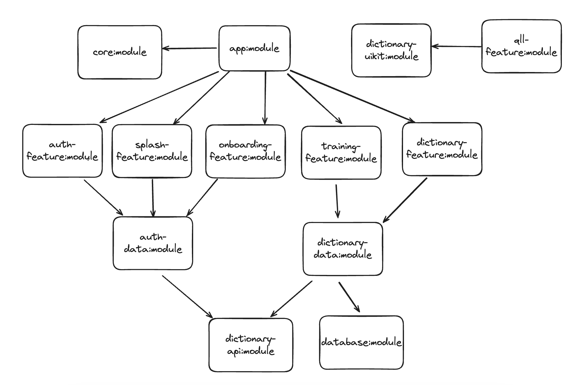
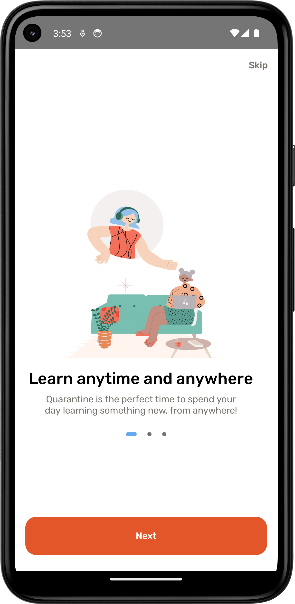
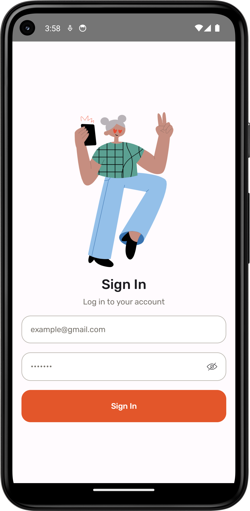
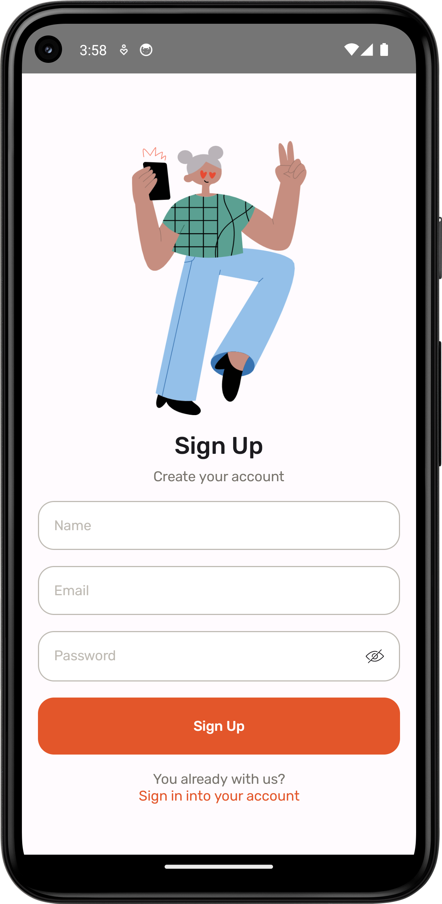
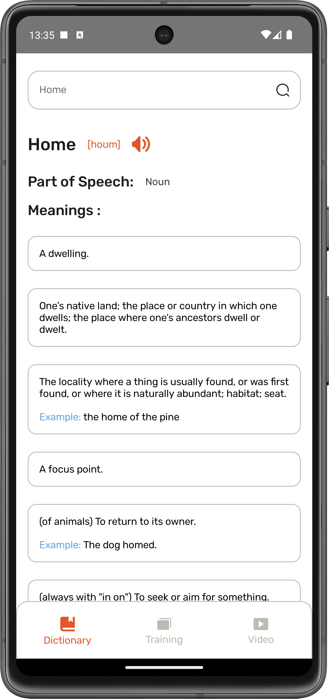
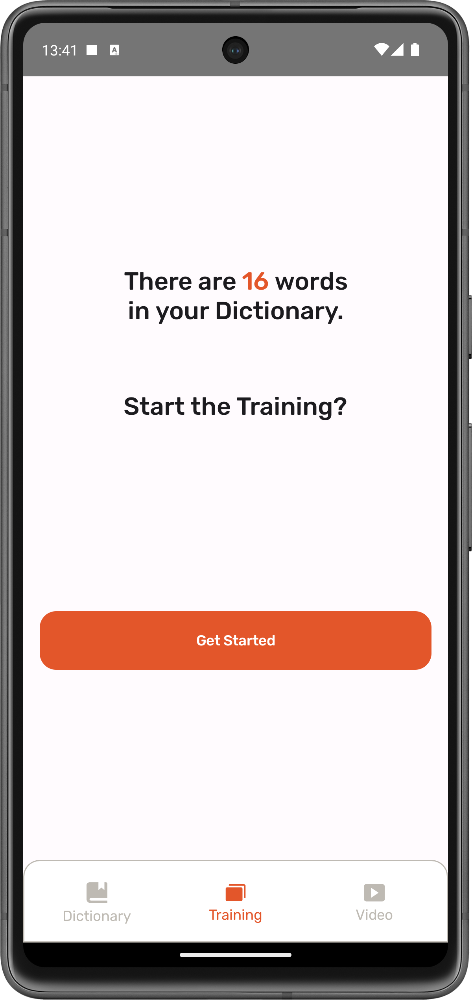
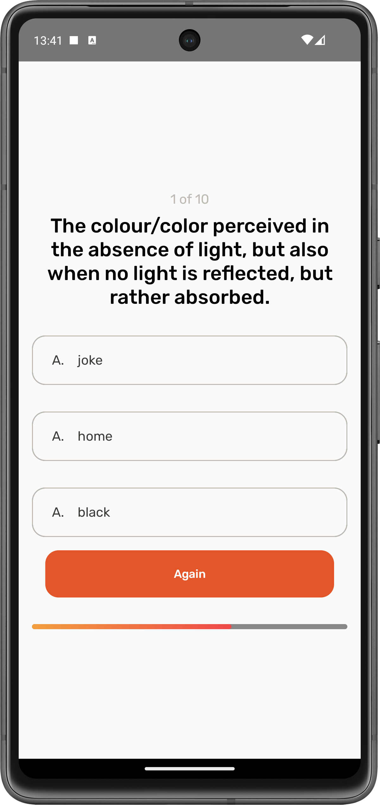
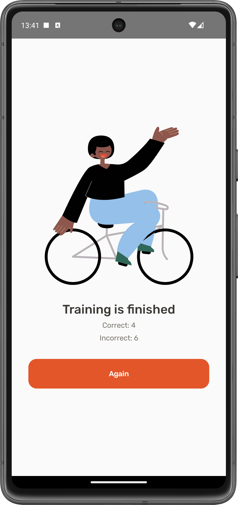
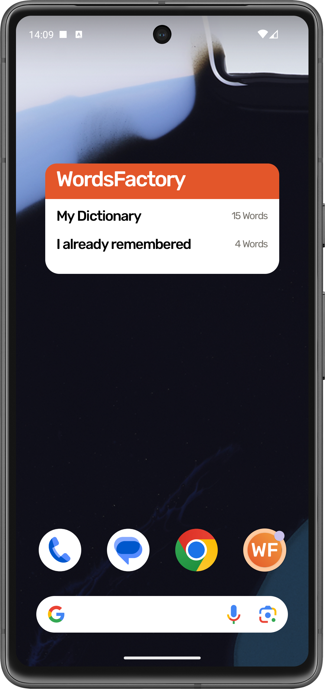

# WordsFactory
Android app for learning English words. Words are looked up in the [Free Dictionary API](https://dictionaryapi.dev),
saved to a local database and practiced in short quizzes.

## Features
- Sign up and sign in with email and password or with a Google account (Firebase Authentication);
- Word lookup: phonetics, parts of speech and definitions from `api.dictionaryapi.dev`;
- Saved words are stored in a Room database;
- Training: a quiz of up to 10 questions built from words that are not learned yet. Each question has three options:
  the correct word and two other words from the user's dictionary;
- A correct answer increases the word's `skillRatio` by 1, a wrong answer decreases it by 1. A word with `skillRatio`
  of 5 or more is counted as learned and is no longer asked in training;
- Home screen widget (Jetpack Glance) with the number of saved and learned words;
- Video screen: the British Council [video zone](https://learnenglish.britishcouncil.org/general-english/video-zone)
  opened in a `WebView`.

## Requirements
- JDK 17 or higher;
- Android SDK with API level 34 (`compileSdk = 34`);
- Device or emulator with Android 10 (API 29) or higher (`minSdk = 29`).

The project uses Gradle 8.6 (wrapper), AGP 8.3.1 and Kotlin 1.9.22.

## Build
```shell
git clone https://github.com/rendivy/WordsFactory.git
cd WordsFactory
./gradlew :app:assembleDebug
```

The APK is written to `app/build/outputs/apk/debug/app-debug.apk`. To build and install it on a connected device, run:

```shell
./gradlew :app:installDebug
```

> **Important:** `app/google-services.json` belongs to the author's Firebase project. To use your own project for
> authentication, replace this file with the one downloaded from your Firebase console.

## Modules
The project is split into 14 modules following the
[Android modularization guide](https://developer.android.com/topic/modularization/patterns#types-of-modules).



- `:app` - entry point, navigation graph, Hilt setup, home screen widget;
- `:core` - navigation routes, input validation use cases, shared exceptions and coroutine dispatchers;
- `:database` - Room database, entities and DAOs;
- `:dictionary-api` - Retrofit client for the Free Dictionary API;
- `:dictionary-uikit` - theme and shared Compose components;
- `:data:auth-data` - Firebase authentication, Google sign-in client, auth state storage in DataStore;
- `:data:dictionary-data` - word and training question repositories;
- `:feature:splash-feature`, `:feature:onboarding-feature`, `:feature:auth-feature`, `:feature:dictionary-feature`,
  `:feature:training-feature`, `:feature:video-feature` - screens;
- `:feature:widget-feature` - reserved for the widget, contains no sources yet. The widget is implemented in `:app`.

## Tech stack
- UI: Jetpack Compose, Material 3, Navigation Compose, Jetpack Glance;
- DI: Hilt;
- Network: Retrofit, OkHttp;
- Storage: Room, DataStore;
- Async: Kotlin Coroutines;
- Auth: Firebase Authentication, Google Play services auth;
- Tests: JUnit 4, Mockito.

## Tests
Unit tests cover `QuestionRepositoryImpl`: question generation and `skillRatio` updates.

```shell
./gradlew :data:dictionary-data:testDebugUnitTest
```

## Screenshots
| Onboarding | Sign in | Sign up | Dictionary |
|---|---|---|---|
|  |  |  |  |

| Training | Question | Result | Widget |
|---|---|---|---|
|  |  |  |  |

## Limitations
- Google sign-in works only in builds signed with a certificate whose SHA-1 is registered in the Firebase project from
  `google-services.json`. Email sign-in has no such restriction;
- Word lookup supports **English only**: the base URL is `https://api.dictionaryapi.dev/api/v2/entries/en/`;
- With fewer than three saved words, training questions get fewer than three options.

## Feedback
To ask a question, suggest a feature or report a bug, create an [issue](https://github.com/rendivy/WordsFactory/issues).
Describe your question or suggestion in the "Description" field.
If you report a bug, add the steps to reproduce it.
